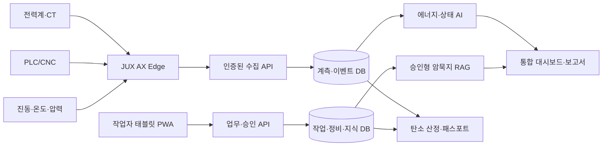

# JUX Smart Factory AX — 개발 방향 및 실행계획

작성일: 2026-10-18  
상태: 제안·설계 초안 (성능·절감률·인증·예산 미확정)  
GitHub: https://github.com/coba8002-code/Gumi-axfactory

## 1. 개발 비전

**공장의 계측 데이터와 작업자의 경험(암묵지)을 결합하여 운영할수록 개선되는 지속 성장형 제조 AI 플랫폼**을 구축한다.

- **에너지 절감:** 설비별 전력·운전·생산 데이터를 AI가 분석하여 낭비를 발견하고 개선안을 제시하며, 개선 전후 절감량을 검증한다.
- **암묵지 AI:** 설비 정지·고장 원인, 작업자 조치, 해결 결과를 기록·승인·검색하여 재사용한다.
- **문서 자동화:** 작업일지, 점검표, 정비기록, 교대 인수인계, 불량기록을 태블릿으로 디지털화하고 자동 보고서를 만든다.
- **상태·품질 관리:** 전류·전력·진동·온도·CNC 알람을 결합해 이상징후를 분석하고, 품질 라벨이 확보되면 불량 감소 모델을 검증한다.
- **탄소 패스포트:** 에너지·공정·제품 LOT와 배출계수 이력을 연결해 검증 가능한 탄소 데이터를 생성한다.

차별점은 개별 FEMS·MES를 교체하는 것이 아니라 **이상 감지 → 현장 조치 → 검증 → AI 지식화 → 경제효과 확인**을 하나의 업무 흐름으로 연결하는 데 있다.

## 2. 도입 대상과 구축 원칙

- 구미산단 CNC·금속가공·자동차부품 제조기업 및 컴프레서·냉각·공조 설비.
- 선도 공장 2~3곳 PoC → 기본형 30개사 실증 → 성과 검증 후 단계적 확산.
- 모든 기계에 별도 장치를 부착하지 않는다. **공장 메인 전력계 1개 + 핵심 설비 2~3곳 전력계 + 기존 PLC/CNC 읽기 전용 데이터**를 우선 사용한다.
- 기존 ERP·MES·FEMS와 API 연동하고 기업별 데이터·지식·접근권한을 분리한다.
- 초기에는 설비 자동 제어를 제외한다. AI는 안전 검토가 필요한 개선안을 권고하고 현장 담당자가 실행한다.

## 3. 계측 하드웨어 설계

| 장비 | 수량/위치(예시) | 측정·역할 | 유의사항 |
|---|---|---|---|
| 3상 전력계 + CT | 메인 1, 주요 설비 2~3 | kW, kWh, RMS 전류, 역률, 피크 | 정격·정확도·통신·검교정 확인 |
| Waveshare ESP32-S3-ETH-8DI-8RO | 공장당 1대 후보 | RS485·Ethernet·DI 수집 | **전력계 자체가 아님**, 비 PoE 일반형 기준 |
| 온도·습도 센서 | 설비/환경별 선택 | 과열·공조 조건 보조 지표 | 측정 위치·정확도 확인 |
| 진동 센서 | 모터·베어링 하우징 | RMS·FFT 이상징후 | 적합한 샘플링·장착 검증 |
| 압력·유량 센서 | 컴프레서 PoC | 누설·과압·운전 효율 | 배관 시공 및 안전 검토 |
| CNC/PLC 연동 | 기존 설비 | 가동·정지·알람·스핀들 부하 | FANUC 기종/FOCAS 옵션·라이선스 확인 |
| 산업용 태블릿 | 작업조/구역별 | 현장 점검·조치·사진·음성 | 오프라인 저장, 큰 버튼, 보호케이스 |
| 고속 전류 DAQ + 엣지 PC | 정밀형 선도 설비 | MCSA·전류 파형 FFT | 기본형 저속 전력계로 대체 불가 |

**기본형**은 저속 전력·운전상태·작업일지 중심, **정밀형**은 고속 MCSA·진동 분석 중심으로 분리한다. 기존 공장당 400만원은 미검증 예비 BOM이며 태블릿 단말기·시공·정밀형 비용은 재산정한다. 전력계·CT 설치는 자격을 갖춘 전문가가 수행한다.

## 4. 데이터·소프트웨어 구조

- 권장 스택: **FastAPI, PostgreSQL(시계열 확장 검토), React/TypeScript PWA, MQTT 또는 HTTPS, Docker, CI/CD**.
- 데이터 항목: `tenant_id`, `equipment_id`, `sensor_id`, UTC 시각, 측정값, 단위, 데이터 품질, 수집 경로, 이벤트 중복방지 키, 펌웨어/모델 버전.
- 엣지 기능: Modbus RTU/TCP, 데이터 버퍼, 네트워크 장애 후 재전송, 시간 동기화, 원격 설정·로그.
- 보안: TLS, 장비별 인증, 기업별 RBAC, 감사로그, 백업·복구, OT/IT 네트워크 분리 검토.

## 5. 핵심 서비스 개발 명세

### A. Factory AutoLog — 수기 문서 디지털화 (P0)

- 작업 시작/종료, 생산실적, 설비점검, 고장·정지, 예방정비, 부품교체, 품질·불량, 안전점검, 교대 인수인계.
- 기계가 아는 설비명·시간·알람·계측값은 자동 입력, 사람만 아는 원인·조치·결과는 최소 입력.
- 사진·음성·QR, 오프라인 큐, 관리자 승인, 수정 이력, 서식 버전, Excel/PDF 자동 보고.
- 첫 달에 현장 수기 서식 10~20종을 확보하여 공통 템플릿과 업종별 항목 정의.

### B. AX Knowledge / Copilot — 지속 학습 (P1)

1. 센서·PLC 정지 이벤트 자동 생성.
2. 작업자가 원인·조치·결과를 태블릿에 입력.
3. 관리자가 해결 여부와 증빙을 승인.
4. 승인된 사례만 기업 전용 RAG 지식검색에 반영.
5. AI는 유사 사례의 출처와 점검 순서를 제안하며 최종 진단은 담당자가 수행.
6. 검색 적합도·채택률·문제해결시간·오탐률 평가 후 규칙/모델을 버전 관리하여 갱신.

데이터 누적이 곧 자동 재학습을 뜻하지 않는다. **무검증 자동 재학습과 기업 간 비공개 데이터 혼합 금지.**

### C. AX Energy Action — 에너지 절감 (P1)

- 전력·생산량·품목·가동시간·기상 데이터를 함께 수집하고 기준선을 수립.
- 공회전, 컴프레서 누설/과압, 냉각·공조 과다운전 등을 탐색.
- AI가 예상 절감액, 작업 위험, 실행 난이도와 함께 개선안을 제시.
- 담당자가 조치 후 생산량·가동시간·날씨 등을 보정하여 **실제 절감 kWh**를 검증.
- 전력계 설치만으로 절감이 발생하지 않으므로 개선 실행·검증을 서비스 범위에 포함.

### D. 설비 상태·불량 분석 (P1~P2)

- 기본형: 전류 RMS·kW·가동/대기/정지·이상 부하 분류.
- 정밀형: 고속 전류 DAQ/MCSA·진동 FFT·온도·CNC 알람 융합; 오탐률과 고장 라벨로 검증.
- 불량 분석: 제품 LOT, 공정조건, 검사·불량 라벨 확보 후 상관관계와 모델 성능 검증.
- 예지보전의 잔여수명·정확도는 실증 전 확정 성능으로 홍보하지 않는다.

### E. Carbon Engine / Passport (P2)

- 기업 Scope 1/2 활동자료, 배출계수 출처·연도·버전 관리.
- 전력 배출량(tCO₂e) = 사용량(kWh) × 적용 배출계수(kgCO₂e/kWh) ÷ 1,000.
- 공정·제품·LOT별 배분 규칙, 계측 원본, 검교정, 계산 이력, 담당자 승인·제3자 검증 상태 저장.
- ISO 50001·50006·50015, IPMVP, ISO 14064·14067, GHG Protocol 등 **용도별 적용성 검토**.
- CBAM은 해당 품목·신고요건에만 대응. 소프트웨어 표준 대응과 제3자 검증·배출권 인증은 별개.
- 게이트웨이·전력계·전원장치의 KC/전파/전기안전 대상 여부는 완제품 사양 확정 후 시험기관 확인.

## 6. 12개월 개발 로드맵

| 기간 | 단계 | 산출물 | 완료 기준 |
|---|---|---|---|
| M1–2 | 현장 조사·요구사항·설계 | BOM, 설치도, 서식 목록, 데이터 모델 | 선도 공장 요구사항 승인 |
| M2–4 | 엣지·데이터 수집 | 펌웨어, 계측 API, DB, 시뮬레이터 | 재전송·중복·결측 시험 |
| M3–6 | 태블릿·업무 자동화 | PWA, 점검/정비/정지 기록, 승인, 보고 | 작업자 사용성·오프라인 시험 |
| M5–8 | AI 지식·에너지 분석 | RAG, 운전상태 분류, 절감 권고 | 출처·오탐·기준선 평가 |
| M7–9 | 탄소·정밀 실증 | 탄소 엔진, DAQ/진동 PoC | 산정 재현성·진단 성능 시험 |
| M9–11 | 통합·보안·인증 검토 | 권한·감사·백업·시험 자료 | 현장 인수·보안 점검 |
| M11–12 | 경제성 검증·상용화 | 기업 ROI, 운영 매뉴얼, 요금제 | 실측 효과 및 확대 의사결정 |

### 초기 90일 실행계획

- **1~30일:** 공장 2~3곳 현장실사, 기존 서식·전기요금·설비 현황 수집, 장비/통신/인증 검토, 공급사 비교견적.
- **31~60일:** 전력계·ESP32 수집 PoC, PostgreSQL, 태블릿 정지·점검·정비기록, 승인·감사로그, 기초 보고서.
- **61~90일:** 암묵지 RAG 초안, 공회전 탐지, 기준선·ROI 초안, 데이터 품질·보안·현장 UX 검증.

## 7. 경제성 검증

| KPI | 검증 방식 |
|---|---|
| 전력비 절감 | 조건 보정 전후 절감 kWh × 적용 전기요금 |
| 탄소 감축 | 검증된 절감량 × 적용 배출계수 |
| 비가동 감소 | 동일 생산조건의 정지시간·실제 회피 손실 비교 |
| 수기 업무 감소 | 문서 작성·승인·보고 시간 전후 측정 |
| 불량 감소 | 동일 품목·검사기준의 불량률·재작업 비용 비교 |
| AI 성능 | 탐지 오탐률, 검색 적합도·채택률·문제해결시간 |
| 데이터 품질 | 수집 성공률, 결측률, 중복률, 시간 동기화 |

**연간 순편익** = 검증된 전력비 절감 + 실제 회피 가능한 비가동·불량 손실 + 현금화 가능한 업무비 절감 − 운영비 − 추가 개선비.  
**단순 회수기간** = 기업 실부담 초기 투자비 ÷ 연간 순편익(양수일 때).  
업무시간의 금전 환산 가치는 현금 절감과 분리하고, 생산량 감소나 항목 간 중복 편익은 제외한다.

## 8. 예비 예산·운영 모델

| 항목 | 1차년도 가정 |
|---|---:|
| 기본 장비·설치 (30개사) | 1.20억원 |
| 플랫폼·태블릿 SW·AI 개발 | 1.60억원 |
| 현장 진단·교육·검증 | 0.65억원 |
| 클라우드·보안·운영 | 0.75억원 |
| 사업관리·예비비 | 0.80억원 |
| **합계** | **5.00억원** |

위 금액은 **검증되지 않은 제안용 가정**이다. 태블릿 단말기 수량, 정밀 DAQ·진동계, 전기공사, 시험·인증 및 제3자 탄소 검증 비용은 실제 견적 후 포함·재배분해야 한다.

- 공공지원 기본형: 계측·태블릿·기본 보고서·암묵지 기록.
- 기업 유료 고도화형: 정밀센서, AI 진단, MES/ERP 심화 연동, 탄소 패스포트·맞춤 보고.
- JUX 수익: 구축·연동비 + 연간 유지관리 + 선택형 고급 분석 구독.

## 9. 개발 검수·리스크 관리

- 현장 전기안전·OT 네트워크·데이터 권한은 개발 기능보다 우선 검증.
- 장비 측정 정확도·타임스탬프·결측·오프라인 재전송을 자동 시험.
- 기업별 데이터 격리, 감사로그, 백업·복구, 인증·권한 테스트를 필수화.
- AI 추천은 출처·신뢰상태를 표시하며 안전 관련 자동 제어 금지.
- 실증 KPI와 경제성 기준선을 **설치 전에** 합의하고 대조군·조건 보정 가능성을 검토.
- 모델 업데이트는 평가→승인→배포→모니터링→롤백 체계로 운영.

## 10. 당장 착수할 개발 작업

1. GitHub `Gumi-axfactory`의 초기 FastAPI 코드를 검토하고 PostgreSQL·인증·기업별 권한·감사로그부터 보완.
2. 현장 서식 기반 태블릿 PWA의 **설비 선택 → 정지사유 → 조치 → 관리자 승인** 완성.
3. Modbus 전력계 시뮬레이터 및 Waveshare ESP32 게이트웨이 수집기 구현.
4. 자동 일·월간 보고서와 기업별 전력·정지시간 대시보드 구축.
5. 승인된 정비사례만 검색하는 RAG PoC 및 AI 답변 근거 표시.
6. 에너지 기준선·개선조치 이력·탄소 계산의 검증 가능한 데이터 구조 확정.

**최우선 제품:** `JUX AX SENSE Base + Factory AutoLog` — 현장 데이터 수집과 문서 자동화를 먼저 완성한 뒤 AI Energy, Knowledge, Carbon Passport 순으로 확장한다.
